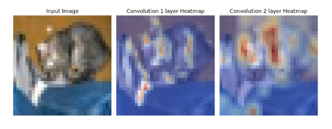
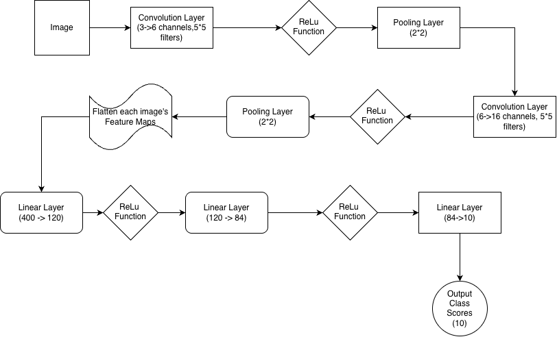
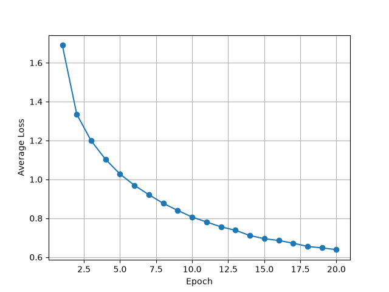
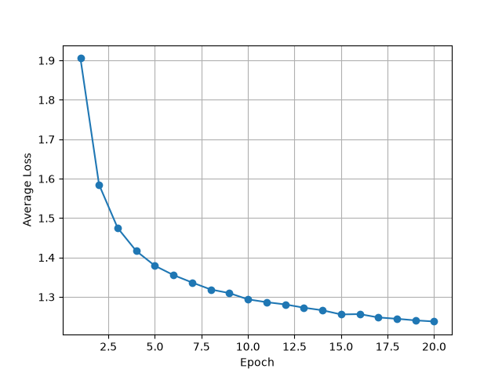

# Grad-CAM for CIFAR-10: visualizing CNN predictions

This project implements Grad-CAM with PyTorch autograd to visualize image regions associated with a CNN's predicted class on CIFAR-10. It examines both convolutional layers of a baseline classifier and compares its classification performance with a deeper CNN.

## Overview

The explainability experiment traces a predicted class score back to convolutional feature maps, calculates gradient-based channel weights, and overlays the resulting heatmaps on the input image. The example shows a cat classified as a dog, illustrating how Grad-CAM can help inspect a misclassification.

The architecture experiment compares a two-convolution baseline with a three-convolution model. It explores how an additional convolution and pooling stage changes feature dimensions, parameter count, and classification accuracy. Grad-CAM is implemented for the baseline model only.

The models and training loop build on the PyTorch [Training a Classifier tutorial](https://docs.pytorch.org/tutorials/beginner/blitz/cifar10_tutorial.html). Extensions include manual Grad-CAM calculations, 20-epoch loss tracking, training-set evaluation, and an additional convolutional stage. PyTorch provides the layers, optimizer, loss, and automatic differentiation; torchvision provides the dataset and transforms. See [attribution](THIRD_PARTY_NOTICES.md).

## Grad-CAM

The implementation follows [Grad-CAM: Visual Explanations from Deep Networks via Gradient-based Localization](https://arxiv.org/abs/1610.02391) by Ramprasaath R. Selvaraju et al.

For the baseline model, the first test image is passed through the network while retaining gradients for the post-ReLU outputs of both convolutional layers. The predicted class's logit is backpropagated to these activations. Spatially averaged gradients provide channel weights; the weighted feature maps are summed and passed through ReLU. Each map is resized to 32 × 32 and normalized before overlaying it on the input image.



The example has a true label of `cat` and a predicted label of `dog`. Grad-CAM highlights positive class-associated regions, but does not establish causal reasoning or fairness. The two maps are normalized independently, so their colors do not represent comparable absolute importance values. Grad-CAM is implemented for the baseline only.

## Dataset and training

[CIFAR-10](https://www.cs.toronto.edu/~kriz/cifar.html) contains 50,000 training and 10,000 test RGB images across 10 balanced classes. Each image is 32 × 32 pixels. The project uses the official train/test split.

Images are converted to tensors and normalized using a mean and standard deviation of 0.5 for each channel, mapping pixel values to approximately [-1, 1]. No augmentation or validation split is used.

| Setting | Value |
|---|---|
| Epochs | 20 |
| Batch size | 4 |
| Loss | Cross-entropy |
| Optimizer | SGD |
| Learning rate | 0.001 |
| Momentum | 0.9 |
| DataLoader workers | 0 |
| Training order | Shuffled |
| Test order | Sequential |

Mean training loss is calculated across all mini-batches for each epoch. The models have no dropout or batch normalization. Training does not set a random seed.

**Training and evaluation run on CPU.** The training scripts print an available device but do not transfer the models or input tensors to CUDA or MPS.

## Architectures

Dimensions omit batch size. Convolutions use stride 1 with no padding. Max pooling uses a 2 × 2 kernel and stride 2.

| Stage | Baseline CNN | Deeper CNN |
|---|---|---|
| Input | 3 × 32 × 32 | 3 × 32 × 32 |
| Conv1, 5 × 5 + ReLU | 6 × 28 × 28 | 6 × 28 × 28 |
| Max pool | 6 × 14 × 14 | 6 × 14 × 14 |
| Conv2, 5 × 5 + ReLU | 16 × 10 × 10 | 16 × 10 × 10 |
| Max pool | 16 × 5 × 5 | 16 × 5 × 5 |
| Conv3, 3 × 3 + ReLU | — | 10 × 3 × 3 |
| Max pool | — | 10 × 1 × 1 |
| Flatten → FC1 + ReLU | 400 → 120 | 10 → 120 |
| FC2 + ReLU → FC3 | 120 → 84 → 10 | 120 → 84 → 10 |
| Trainable parameters | 62,006 | 16,656 |

The final layer returns logits, which are passed directly to cross-entropy loss during training.



## Results

Evaluation of the saved checkpoints on the complete CIFAR-10 splits produced the following accuracies. The [evaluation record](results/checkpoint_evaluation.json) contains exact counts, per-class results, environment versions, and source/checkpoint hashes.

| Model | Training accuracy | Test accuracy | Epoch 20 mean training loss |
|---|---:|---:|---:|
| Baseline CNN | 78.58% | 61.87% | 0.638 |
| Deeper CNN | 57.79% | 53.56% | 1.238 |

Loss curves show the original 20-epoch training runs. Accuracies were confirmed by evaluating the saved models on CIFAR-10 on October 23, 2026. See [detailed results](docs/RESULTS.md) for per-class accuracy, correct counts, and the evaluation setup.

The baseline's test accuracy is 8.31 percentage points higher. The deeper model reduces the representation entering the classifier from 400 values to 10 and has fewer parameters overall. This bottleneck may contribute to its lower accuracy. Depth, pooling, representation size, parameter count, and random initialization all differ, so this comparison does not isolate the effect of adding a layer.

| Baseline training loss | Deeper model training loss |
|---|---|
|  |  |

Training loss decreases in both models, with the baseline reaching a lower final loss.

## Setup

Use a native arm64 Python installation on Apple Silicon. Checkpoint evaluation completed with Python 3.13.9, PyTorch 2.14.0, torchvision 0.29.0, and NumPy 2.5.3. The training scripts were also checked with Python 3.14.0 and Matplotlib 3.11.2. Dependency versions are listed in [requirements.txt](requirements.txt), with a full package snapshot in [environment-original.txt](docs/environment-original.txt).

From the repository root:

```bash
python3 -m venv .venv
source .venv/bin/activate
python -m pip install -r requirements.txt
python -m pip check
python tools/verify_artifacts.py
```

For installation compatibility, see the [PyTorch installation guide](https://pytorch.org/get-started/locally/) and [torchvision compatibility table](https://github.com/pytorch/vision#installation).

### Evaluate saved checkpoints

```bash
python tools/evaluate_checkpoints.py --data-root data --download
```

The evaluator runs inference on CPU and saves overall/per-class accuracies, sample counts, environment versions, and artifact hashes to `runs/evaluation/metrics.json`. Omit `--download` if CIFAR-10 is already available. If the output file exists, use a different `--output` path to retain both evaluations.

### Train the models

Run each training script from a separate run directory to retain the saved checkpoints and figures in the model directories.

```bash
mkdir -p runs/baseline_cnn
cp baseline_cnn/problem1_cifar10.py runs/baseline_cnn/
python -u runs/baseline_cnn/problem1_cifar10.py > runs/baseline_cnn/train.log 2>&1
```

```bash
mkdir -p runs/deeper_cnn
cp deeper_cnn/problem2_cifar10.py runs/deeper_cnn/
python -u runs/deeper_cnn/problem2_cifar10.py > runs/deeper_cnn/train.log 2>&1
```

Keep the repository root as the working directory. Data is stored in `./data`; each script writes its checkpoint and figures beside itself. Reusing a run directory replaces that run's outputs. Interactive plot windows pause execution until closed; use `MPLBACKEND=Agg` before the Python command for noninteractive execution.

Each training script trains from random initialization for 20 epochs, saves its weights, and evaluates the resulting model. See [validation](docs/VALIDATION.md) for evaluation details and reproducibility checks.

## Limitations and future work

- No validation split or controlled multi-seed comparison is available.
- The checkpoints contain model weights but no optimizer state, seed, or training configuration for exact resumption.
- Grad-CAM covers one image and its predicted class; no demographic bias experiment was conducted.
- New training runs can produce different results because training does not set a random seed.

Future experiments could compare pooling strategies, preserve more spatial information in the deeper model, evaluate multiple seeds, and inspect Grad-CAM maps across correct and incorrect predictions. Device transfers, configurable output paths, and structured training logs would improve reproducibility.

## Repository guide

- `baseline_cnn/`: baseline model, weights, architecture diagram, loss curve, and Grad-CAM figure.
- `deeper_cnn/`: deeper model, weights, and loss curve.
- `results/`: checkpoint evaluation, overall/per-class accuracy, and training loss.
- `tools/`: checkpoint evaluation and model verification utilities.
- `docs/`: result details, validation, environment snapshot, and artifact hashes.
- `THIRD_PARTY_NOTICES.md`, `licenses/`: references and upstream license notice.
